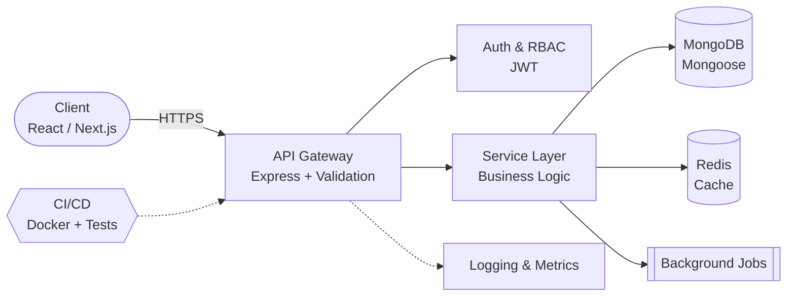

<div align="center">


<a href="https://github.com/Haseeb-MernStack"></a>

<br/>

<p>
  
  <a href="https://github.com/Haseeb-MernStack?tab=followers"></a>
  <a href="https://www.npmjs.com/package/express-smart-response"></a>
  
</p>

</div>

---

## `$ whoami`

```ts
const haseeb = {
  role: "MERN Stack Engineer",
  focus: ["Scalable web apps", "Developer tooling", "Open source"],
  building: ["Learning Management System", "Commune (community open source)"],
  shipping: ["express-smart-response", "clean-mongoose"],
  learning: ["TypeScript (deep)", "Docker", "Microservices", "MCP Servers", "Cloud / CI-CD"],
  principles: ["Maintainable first", "Typed contracts", "Tested & automated", "Documented", "Open by default"],
  contact: "mernstackerr@gmail.com",
} as const;
```

I turn real problems into **production-ready, maintainable software**. I care about the parts of engineering that outlast a single release: clear architecture, consistent API design, meaningful tests, and documentation that respects the next developer's time.

---

## 🌟 Featured: Commune

<div align="center">

<a href="https://github.com/Haseeb-MernStack/commune"></a>

</div>

> **Commune** is a community-driven, fully open-source project, built in public to industry standards and open to developers of every level.

| | |
|---|---|
| 🎯 **Mission** | Build something genuinely useful, in the open, with the community |
| 🧱 **Engineering** | Clean architecture, TypeScript, linting, automated tests, CI/CD |
| 📖 **Docs** | Setup guide, contribution guide, code of conduct |
| 🤝 **Contributors** | Beginner-friendly issues labeled `good first issue` |
| 📜 **License** | MIT |

<p align="center">
  <a href="https://github.com/Haseeb-MernStack/commune"></a>
  <a href="https://github.com/Haseeb-MernStack/commune/blob/main/CONTRIBUTING.md"></a>
  <a href="https://github.com/Haseeb-MernStack/commune/issues"></a>
</p>

---

## 🏗️ How I Architect



| Principle | In practice |
|---|---|
| **Maintainable first** | Code is read far more than it is written, so I write for the reader |
| **Consistent APIs** | Predictable response shapes, clear errors, strict input validation |
| **Typed contracts** | TypeScript across the stack so interfaces fail at compile time, not in production |
| **Tested & automated** | Tests and CI catch problems before users do |
| **Open by default** | Sharing work and learning in public makes everyone better |

---

## 📦 Open-Source Packages

<div align="center">

<a href="https://www.npmjs.com/package/express-smart-response"></a>
<a href="https://github.com/Haseeb-MernStack/clean-mongoose"></a>

</div>

| Package | What it solves | Stack |
|---|---|---|
| [**express-smart-response**](https://www.npmjs.com/package/express-smart-response) | Consistent, clean API responses for Express apps | Node.js, Express |
| [**clean-mongoose**](https://github.com/Haseeb-MernStack/clean-mongoose) | Safe API output from Mongoose documents: `_id` becomes `id`, `__v` and private fields are removed | TypeScript, Mongoose |

---

## 🧰 Tech Stack

<div align="center">


</div>

---

## 📊 Activity & Stats

<div align="center">


<br/>


<br/>


</div>

---

## 🔭 Roadmap

- [x] Publish open-source npm packages
- [x] Build a full-stack LMS on the MERN stack
- [ ] Grow **Commune** with contributors, releases, and a public roadmap
- [ ] Move toward microservices and cloud-native deployment (Docker, AWS, CI/CD)
- [ ] Build MCP servers and AI-assisted developer tooling
- [ ] Go deeper on Next.js App Router with SSR/ISR patterns

---

## 🤝 Let's Build Together

Open to conversations about **open source, backend architecture, and developer tooling**. Want to contribute to Commune? Open an issue or send a pull request.

<div align="center">

<a href="https://linkedin.com/in/haseeb-mernstack-973aa732a/"></a>
<a href="mailto:mernstackerr@gmail.com"></a>
<a href="https://www.youtube.com/@haseebmernstack"></a>
<a href="https://www.instagram.com/haseeb_mernstack/"></a>
<a href="https://www.facebook.com/profile.php?id=61568415121623"></a>
<a href="https://bsky.app/profile/haseeb-mernstack.bsky.social"></a>

<br/><br/>

**Clean code. Scalable systems. Open source.**


</div>
